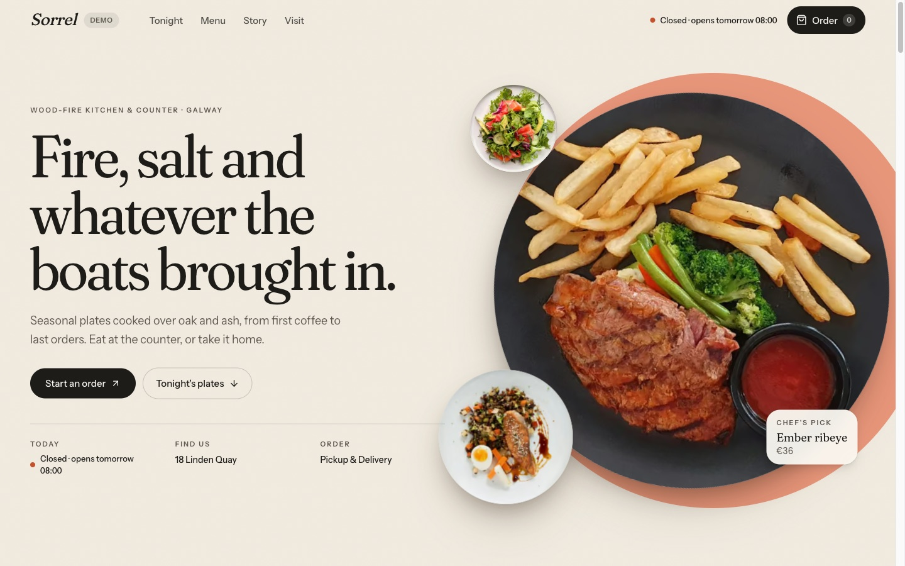
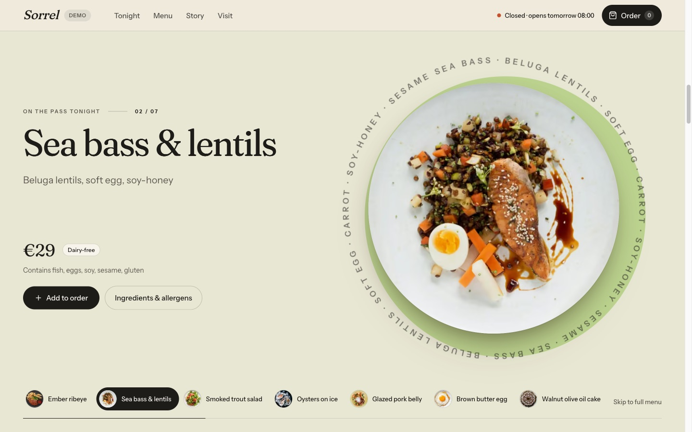
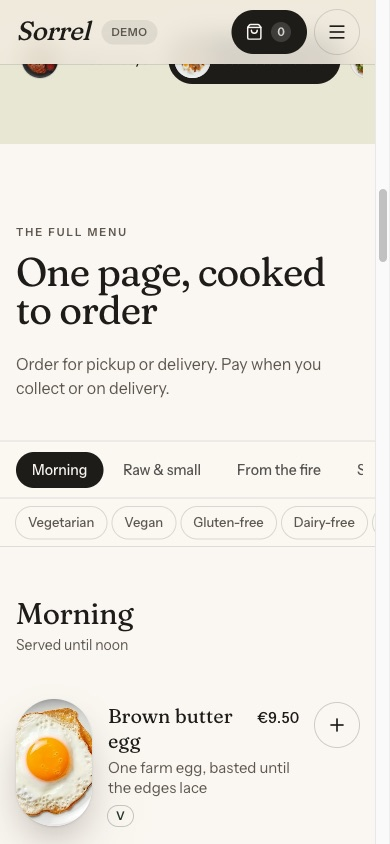
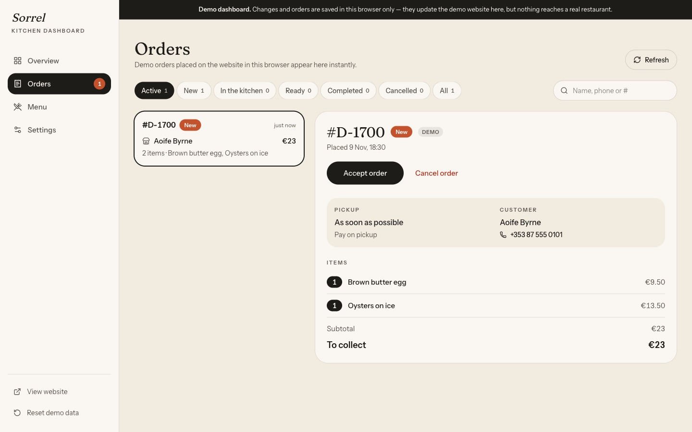

# Sorrel — restaurant website & kitchen dashboard

A complete single-restaurant starter by Profit Studio: an editorial storefront with an animated dish showcase, a full menu, pickup and delivery ordering, and a phone-friendly dashboard for orders, menu and settings.

**Live demo: [sorrel-restaurant-demo.vercel.app](https://sorrel-restaurant-demo.vercel.app)** · **Demo dashboard: [/admin](https://sorrel-restaurant-demo.vercel.app/admin)**



| The dish showcase | On a phone | The dashboard |
| --- | --- | --- |
|  |  |  |

What's inside:

- **The storefront:** hero, an interactive dish showcase (scroll-driven on desktop, swipe on phones), the full menu with categories, dietary filters and allergens, dish details, story, opening hours and location.
- **Ordering:** a cart, pickup or delivery, delivery fee and minimum, "as soon as possible" or a later time, all checked against your opening hours. Prices are always calculated on the server.
- **The dashboard** at `/admin`: live orders and their status, the menu with photos, prices and sold-out switches, categories, and restaurant settings.

It runs in two modes:

| | Demo Mode (default) | Production Mode |
|---|---|---|
| Needs | Nothing | A Supabase project (the free plan works) |
| Menu & settings | Sample restaurant | Your database, edited in the dashboard |
| Orders | Saved in the visitor's browser only, clearly labelled, never sent | Saved securely, priced on the server |
| Dashboard | Open demo, changes stay in that browser | Staff login required |

The mode switches automatically when the Supabase environment variables are present.

---

## The Profit Studio workflow

1. **Get the starter**: copy this repository to your own GitHub account.
2. **Deploy on Hostinger without Supabase**: your site is online in Demo Mode within minutes.
3. **Customise with Claude Desktop**: your name, photos, colours and words.
4. **Connect Supabase**: real orders and a private, password-protected dashboard.
5. **Configure your restaurant and launch.**

## Step 1: Get the starter

Click **Use this template → Create a new repository** at the top of this page (or **Code → Download ZIP**). Your copy can be private; it works either way.

To run it on your own computer (optional), install [Node.js 22](https://nodejs.org), then:

```bash
npm install
npm run dev
```

Open http://localhost:3000 for the website and http://localhost:3000/admin for the demo dashboard.

## Step 2: Deploy on Hostinger (no database yet)

Sorrel is a Next.js app, so it needs a **Node.js web app** on Hostinger (not static hosting).

1. In hPanel, add a **Node.js web app** and connect your GitHub repository.
2. Use:
   - **Node version:** 22
   - **Build command:** `npm run build`
   - **Start command:** `npm run start`
3. Don't add any environment variables yet. Deploy.

You get the full website and the demo dashboard at `/admin`. Demo orders and dashboard edits stay in each visitor's own browser and are never sent anywhere; the site says so clearly.

## Step 3: Customise with Claude Desktop

Open your project folder in [Claude Desktop](https://claude.ai/download)'s **Code** tab and describe what you want, for example:

- *"Change the restaurant name to Harbour Kitchen and use a deep green accent colour."*
- *"Replace the sample dishes with my menu from this list…"*
- *"Rewrite the story section for a family-run Italian trattoria."*

Push the changes to GitHub and Hostinger redeploys. Useful places to know:

- `lib/seed.ts`: the sample restaurant (name, hours, story, dishes). It is also what **Import sample menu** copies into your database later.
- `app/globals.css`: colours and type tokens
- `app/layout.tsx`: fonts and page title
- `public/images/`: dish and interior photos (square, top-down dish photos look best)

Once Supabase is connected (step 4), most of this content is edited from the dashboard instead.

## Step 4: Connect Supabase (Production Mode)

1. Create a project at [supabase.com](https://supabase.com).
2. In **SQL Editor**, paste and run the whole of `supabase/migrations/0001_init.sql`. This creates the tables, security rules (Row Level Security), access grants and the `dish-images` storage bucket. It is safe to run again.
3. In **Authentication → Sign In / Providers**, turn off **Allow new users to sign up** (you create staff accounts yourself), and under **Email** turn on **Prevent use of leaked passwords** if your plan offers it. Then in **Authentication → Users**, click **Add user** and create the owner's account (email and a strong password of at least 10 characters).
4. Make that user an admin. In **SQL Editor** run (with your email):

   ```sql
   insert into public.admins (user_id)
   select id from auth.users where email = 'owner@example.com';
   ```

5. In Hostinger, open your Node.js app's **Environment variables** and add (values from Supabase → **Connect**, or **Project Settings → API Keys**):

   | Variable | Value |
   |---|---|
   | `NEXT_PUBLIC_SUPABASE_URL` | your Project URL |
   | `NEXT_PUBLIC_SUPABASE_PUBLISHABLE_KEY` | the publishable key (`sb_publishable_…`) |
   | `SUPABASE_SECRET_KEY` | the secret key (`sb_secret_…`). Server only; never share it or put it in code |
   | `TRUSTED_PROXY` | `hostinger` (see [Order rate limiting behind a proxy](#order-rate-limiting-behind-a-proxy)) |
   | `NEXT_PUBLIC_SITE_URL` | your domain, e.g. `https://harbourkitchen.ie` |
   | `ORDER_IP_SALT` | optional: any long random string |

6. **Redeploy** (rebuild). Public values are built into the site, so rebuild after changing any of them.
   - *"Could not load the menu from Supabase"*: a key is wrong or step 2 wasn't run. The site never falls back to sample data in Production Mode.
   - *"Environment variables need fixing"*: only one of the two public Supabase values is set (which would otherwise quietly build the demo site), or a secret key was given a `NEXT_PUBLIC_` name.
7. Go to `/admin`, sign in, and click **Import sample menu**, or start from an empty menu.
8. While signed in, open `/admin/connection-check`. `address` should match what a "what is my IP" website shows for your connection (check from your phone on mobile data too). If it can't be established, see [Order rate limiting behind a proxy](#order-rate-limiting-behind-a-proxy).

## Step 5: Configure your restaurant and launch

- [ ] Settings → restaurant name, address, phone, email, map link
- [ ] Settings → opening hours and **timezone**. Customers can order "as soon as possible" while you're open, and pre-order for later the same day before you open. Outside those times, checkout is closed.
- [ ] Settings → pickup and/or delivery, delivery fee and minimum
- [ ] Menu → your dishes, prices, allergens and photos
- [ ] Menu → choose which dishes appear in the homepage showcase
- [ ] Place a test order, then move it through the statuses in **Orders**
- [ ] Connect your domain in Hostinger

---

## How it works

**Stack:** Next.js 16 (App Router, Cache Components), React 19, TypeScript, Tailwind CSS 4, shadcn/ui (Base UI), GSAP, Supabase.

```
app/(site)/          storefront: home and checkout
app/admin/(panel)/   dashboard: overview, orders, menu, settings
app/admin/login/     staff sign-in (Production Mode)
app/actions/         placeOrder server action
app/admin/actions.ts dashboard server actions (each re-checks admin access)
components/ui/       shadcn components + dish-orbit-carousel (the showcase)
components/site/     storefront sections
components/admin/    dashboard components
lib/                 domain logic: pricing, validation, hours, order status, client IP
lib/data/            database reads (cached storefront data)
lib/admin/           dashboard backends: demo (browser) and live (Supabase)
supabase/migrations/ database schema, security rules, storage
tests/               unit tests, plus security tests against a real Supabase project
```

**Ordering security**

- The browser sends only dish ids, quantities and contact details. The server re-reads the current menu, rejects unavailable or unknown dishes, applies the delivery minimum and fee, checks opening hours and the requested time, and computes every total itself (`lib/pricing.ts`, `lib/hours.ts`).
- If a price changed while the customer was on the checkout page, the order is refused and the page shows the new total. A different amount is never charged silently.
- The order and its lines are written in one transaction by a database function only the server key can call (`place_order`). It also checks the lines add up.
- Duplicate protection: each checkout carries a one-time key, so a double tap or a retry after a lost connection returns the same order instead of creating a second one.
- Abuse prevention: a honeypot field, a minimum form-fill time, and rate limits enforced inside the database (8 orders per connection and 60 orders site-wide per 10 minutes), so they hold even with several servers. IP addresses are stored only as salted hashes. Adjust the limits at the top of `app/actions/orders.ts`.

**Order rate limiting behind a proxy**

Anyone can send a fake `X-Forwarded-For` header, so the app never trusts it by default (`lib/client-ip.ts`). Each proxy *appends* the address that connected to it, so only entries at the end of the header, added by proxies you control, are reliable.

- **Hostinger:** set `TRUSTED_PROXY=hostinger`. Per Hostinger's documentation ([Hostinger CDN: visitor IP addresses](https://www.hostinger.com/support/?p=18718)), Hostinger CDN appends the address that connected to it as the **last** `X-Forwarded-For` entry, earlier entries can't be trusted, and Node.js apps must read the header themselves. The app uses that last entry and ignores `X-Real-IP`, `CF-Connecting-IP` and every earlier entry. Keep Hostinger CDN switched on for the site.
- **Another host:** set `TRUSTED_PROXY` to the number of proxies you run that each append to `X-Forwarded-For` (usually `1`).
- **Not set, or the address can't be established:** the per-connection limit is skipped for that order (and the server logs a warning) rather than putting every customer in one shared bucket, which would block real customers. The site-wide limit and duplicate protection still apply.
- IPv6 visitors are limited per /64 network, because one household or attacker typically controls a whole /64. IPv4 addresses are limited individually; 8 orders per 10 minutes leaves room for an office or family on one connection.
- Putting Cloudflare or another proxy in front of Hostinger changes which entry is the visitor: the last entry would then be Cloudflare's. Re-check `/admin/connection-check` after any change to your DNS or proxy setup.

**Dashboard security**

- `proxy.ts` redirects signed-out visitors away from `/admin`.
- Every dashboard server action verifies the signed-in user is listed in `admins`.
- Row Level Security enforces the same rule in the database, including for image uploads, so a bug in the app still can't let a non-admin write. Visitors can read only the menu and public settings; orders are visible to admins only.
- Staff can change an order's **status** and nothing else (no totals, no customer details), and the database itself only allows the kitchen workflow: new → accepted → preparing → ready → completed, or cancelled before completion.
- Uploaded photos are checked to really be JPG, PNG, WebP or AVIF images, and replaced or deleted dish photos are removed from storage.
- The secret key is only read by server code (`lib/supabase/admin.ts` imports `server-only`).
- A real restaurant site can't be shown inside another website's frame, and its dashboard can't be framed at all.

**The showcase** (`components/ui/dish-orbit-carousel.tsx`) pins and follows the page scroll on large screens with motion enabled, and becomes a swipe/tap carousel on phones, tablets and with reduced motion. The scroll section is finite (no looping or scroll-jacking) and has a "Skip to full menu" link. It works with any number of dishes the owner selects.

## Public demo deployments

The live demo above is this repository deployed with one environment variable, `PUBLIC_DEMO_MODE=true`, and nothing else. That setting:

- refuses to build if any Supabase variable is present, so a public demo can never be connected to a database;
- lets the site be shown inside the Profit Studio showcase (`https://profitstudio.app`) and nowhere else.

You don't need it for your own restaurant.

## Scripts

```bash
npm run dev        # development server
npm run build      # production build
npm run start      # serve the production build
npm run lint
npm run typecheck
npm test           # unit tests (no database needed)
npm run test:supabase  # security tests against a real Supabase project (see below)
```

### Security tests against Supabase

`npm run test:supabase` signs in as a visitor, a normal user and an admin and checks what each can and can't do: reading orders, changing the menu, uploading images, signing up, making themselves an admin, skipping order statuses, duplicate orders and the rate limits. Run it against a **separate test project**, never your live restaurant. It needs, in `.env.local`:

```bash
SORREL_TEST_ADMIN_EMAIL=...        # a user listed in the admins table
SORREL_TEST_ADMIN_PASSWORD=...
SORREL_TEST_NONADMIN_EMAIL=...     # a user who is NOT an admin
SORREL_TEST_NONADMIN_PASSWORD=...
```

It creates a few synthetic orders and one image and deletes them afterwards. These test accounts belong in your local `.env.local` only; never add `SORREL_TEST_*` variables to your hosting.

## License & credits

MIT License (see [LICENSE](LICENSE)). Food and interior photography from [Unsplash](https://unsplash.com) (Unsplash License), cropped and optimised for this project. Typefaces: Fraunces and Instrument Sans (SIL Open Font License), loaded via `next/font`.
